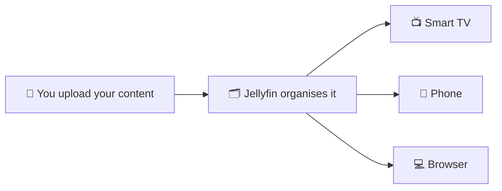
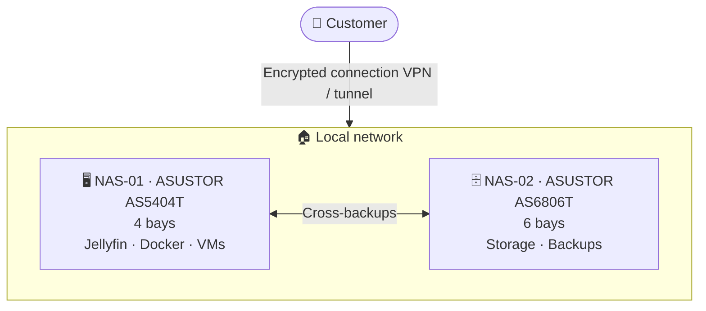
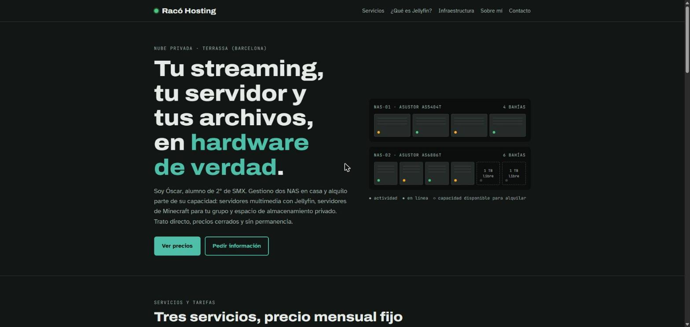

<div align="center">

# 🖧 Racó Hosting

**Self-managed private cloud · Jellyfin · Minecraft · Storage**

A project by **Óscar**, a second-year **SMX** student (Spain's vocational diploma in computer systems and networks)

[🇪🇸 Español](README.md) · **🇬🇧 English**


[🌐 Website](https://oskillar28.github.io/raco-hosting/en/) · [💶 Pricing](#-services-and-pricing) · [🏗️ Infrastructure](#️-infrastructure) · [📬 Contact](#-contact)

</div>

---

## 📌 Overview

**Racó Hosting** is a small-scale hosting project built on **two NAS servers** that I manage at home. I offer part of their capacity to individuals and groups of friends for three services:

| Service | What it's for | Price |
|---|---|---:|
| 🎬 **Jellyfin** | Your own private media server ("Netflix with your own content") | **€5/month** |
| ⛏️ **Minecraft** | Dedicated 24/7 server for your group | **€10/month** |
| 💾 **1–16 TB storage** | Private space for backups, photos and documents | **from €2.99/month** |

> Monthly billing, **no long-term contract**. You deal directly with the person who runs the servers.

---

## 👨‍🎓 About me

I'm in the **second year of SMX** (Sistemas Microinformáticos y Redes) and I put what I learn in class into practice with my own home lab: networking, Linux, virtualisation, containers and backups. This project shows skills from the course in a real environment with real users:

- Administration of **network operating systems** (Linux, ASUSTOR ADM)
- **Network services**: streaming, game servers, file sharing
- **IT security**: encrypted remote access, users and permissions, backups
- **Virtualisation and containers**: Docker and VirtualBox

---

## 💶 Services and pricing

### 🎬 Jellyfin — €5/month

**What is it?** [Jellyfin](https://jellyfin.org) is free, open-source software that turns a server into your own streaming service. It organises films, series, music and photos, fetches cover art and synopses, remembers where you left off and plays everything on any device.

**What's included?**
- ✅ Personal account on the Jellyfin server
- ✅ Apps for Smart TV, Android, iOS and web browser
- ✅ Remote access over an encrypted connection
- ✅ No ads and no third-party subscriptions

**How it works:**



> ⚠️ The service is **the server**, not the content. Each customer uploads material they have the right to use. No films or series are sold or shared.

### ⛏️ Minecraft server — €10/month

- ✅ Dedicated **Java Edition** server for your group, online 24/7
- ✅ **Whitelist**: only authorised players can join
- ✅ **Daily backup** of the world
- ✅ Plugins or mods on request
- ℹ️ Designed for small groups (up to ~10 players)

### 💾 Storage — from €2.99/month

**Capacity available to rent (updated live):**


| Space | Price | With copy on the 2nd NAS | € per TB |
|---:|---:|---:|---:|
| **1 TB** | **€2.99/month** | €4.99/month | €2.99 |
| **2 TB** | **€4.99/month** | €6.99/month | €2.50 |
| **8 TB** | **€14.99/month** | €16.99/month | €1.87 |
| **16 TB** ⭐ | **€24.99/month** | €26.99/month | €1.56 |

- All plans on **RAID 5** (survives a single disk failure).
- **Copy on the second NAS:** +€2/month for any size.

- Private folder with your own username and password
- Access via web, app or network drive

---

## 🏗️ Infrastructure



| Device | Role | Details |
|---|---|---|
| **NAS-01** · ASUSTOR AS5404T | Services | 4 bays. Jellyfin, Docker containers, virtual machines |
| **NAS-02** · ASUSTOR AS6806T | Storage | 6 bays. Customer storage and backups |
| **Remote access** | Security | Encrypted connection (VPN/tunnel), no router ports opened |
| **Protection** | Reliability | RAID 5 volume (survives a single disk failure) + regular backups between both NAS servers |
| **UPS** | Power | Rides out short power cuts and shuts the NAS servers down safely if an outage lasts longer |

---

## 🔒 Security and privacy

- Each customer has **their own user account and folder**; nobody else can access their data.
- Services run in **isolated containers**.
- Access from the internet always goes over an **encrypted connection**.
- When you cancel, you can **download all your data** before it is deleted.

## ⚖️ Terms

- Home environment: occasional power or internet outages may happen. Planned maintenance is announced in advance.
- Monthly payment by Bizum or bank transfer, no long-term contract.
- Storing or sharing illegal or unlicensed content is not allowed.

---

## 🌐 Website

### 👉 [Visit the Racó Hosting website](https://oskillar28.github.io/raco-hosting/en/)

[](https://oskillar28.github.io/raco-hosting/en/)

**https://oskillar28.github.io/raco-hosting/en/**

## 🐳 Deploy with Docker

The website is also published as a Docker image on **GitHub Packages**, ready to run on any NAS or server with Docker:

```bash
docker run -d -p 8080:80 --name raco-web --restart unless-stopped ghcr.io/oskillar28/raco-hosting:latest
```

Then open `http://NAS-IP:8080` (Spanish) or `http://NAS-IP:8080/en/` (English). To update it:

```bash
docker pull ghcr.io/oskillar28/raco-hosting:latest && docker rm -f raco-web && docker run -d -p 8080:80 --name raco-web --restart unless-stopped ghcr.io/oskillar28/raco-hosting:latest
```

The image (nginx + the website) is built and published automatically by GitHub Actions every time the website changes.

## 📬 Contact

Interested in a service? Use the **[contact form on the website](https://oskillar28.github.io/raco-hosting/en/#contact)** to tell me which service you want and how many users or players you'll be. I reply by email within 24 hours.

---

<details>
<summary>🛠️ Admin: updating the storage counter</summary>

The website counter and the badges in this README read the file [`docs/capacidad.json`](docs/capacidad.json).

**Quick way (no file editing):**
1. **Actions** tab → **Actualizar espacio alquilado** → **Run workflow**.
2. Choose `alquilar` (rent) or `liberar` (release) and enter the number of TB (for example `1`).
3. Click **Run workflow**. The website and README update within a few minutes.

The workflow won't let you rent more than is available or release more than is rented.

</details>

<div align="center">

**Racó Hosting** · Second-year SMX project · 2026

</div>
