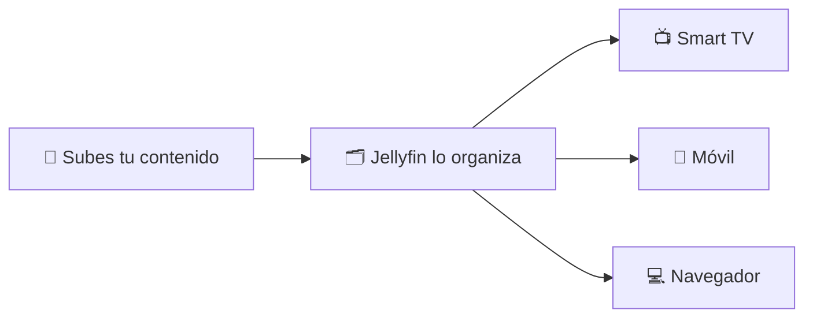
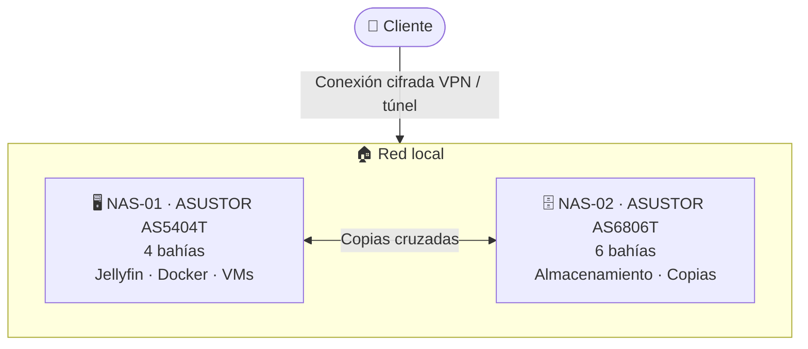
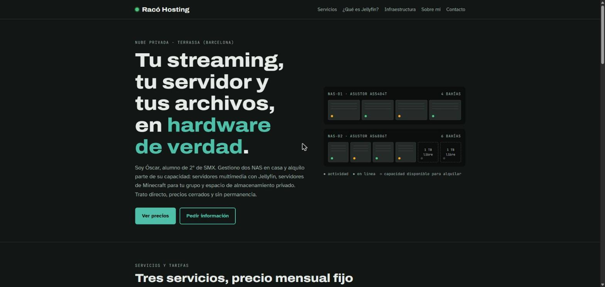

<div align="center">

# 🖧 Racó Hosting

**Nube privada autogestionada · Jellyfin · Minecraft · Almacenamiento**

Proyecto de **Óscar**, alumno de **2º de SMX** (Sistemas Microinformáticos y Redes)


[🌐 Web del servicio](https://oskillar28.github.io/raco-hosting/) · [💶 Tarifas](#-servicios-y-tarifas) · [🏗️ Infraestructura](#️-infraestructura) · [📬 Contacto](#-contacto)

</div>

---

## 📌 Resumen

**Racó Hosting** es un proyecto de alojamiento a pequeña escala montado sobre **dos servidores NAS** que administro en casa. Pongo a disposición de particulares y grupos de amigos parte de su capacidad para tres servicios:

| Servicio | Para qué sirve | Precio |
|---|---|---:|
| 🎬 **Jellyfin** | Tu propio servidor multimedia privado ("Netflix con tu contenido") | **5 €/mes** |
| ⛏️ **Minecraft** | Servidor dedicado 24/7 para tu grupo | **10 €/mes** |
| 💾 **Almacenamiento 1 TB** | Espacio privado para copias, fotos y documentos | **5 – 7 €/mes** |

> Pago mensual, **sin permanencia**. Trato directo con quien administra los servidores.

---

## 👨‍🎓 Sobre mí

Estudio **2º de SMX** y llevo a la práctica lo que aprendo en clase con un laboratorio propio: redes, Linux, virtualización, contenedores y copias de seguridad. Este proyecto demuestra competencias del ciclo en un entorno real con usuarios reales:

- Administración de **sistemas operativos en red** (Linux, ADM de ASUSTOR)
- **Servicios en red**: streaming, servidores de juego, compartición de archivos
- **Seguridad informática**: acceso remoto cifrado, usuarios y permisos, copias de seguridad
- **Virtualización y contenedores**: Docker y VirtualBox

---

## 💶 Servicios y tarifas

### 🎬 Jellyfin — 5 €/mes

**¿Qué es?** [Jellyfin](https://jellyfin.org) es un software libre y gratuito que convierte un servidor en tu propio servicio de streaming. Organiza películas, series, música y fotos, descarga portadas y sinopsis, recuerda por dónde te quedaste y lo reproduce en cualquier dispositivo.

**¿Qué incluye?**
- ✅ Cuenta personal en el servidor Jellyfin
- ✅ Apps para Smart TV, Android, iOS y navegador web
- ✅ Acceso desde fuera de casa mediante conexión cifrada
- ✅ Sin anuncios y sin suscripciones de terceros

**Cómo funciona:**



> ⚠️ El servicio es **el servidor**, no el contenido. Cada cliente sube material sobre el que tiene derechos de uso. No se venden ni comparten películas ni series.

### ⛏️ Servidor de Minecraft — 10 €/mes

- ✅ Servidor **Java Edition** dedicado a tu grupo, encendido 24/7
- ✅ **Lista blanca**: solo entran los jugadores autorizados
- ✅ **Copia de seguridad diaria** del mundo
- ✅ Plugins o mods bajo petición
- ℹ️ Pensado para grupos pequeños (hasta ~10 jugadores)

### 💾 Almacenamiento — desde 5 €/mes

**Capacidad para alquilar (se actualiza en tiempo real):**


| Plan | Capacidad | Protección | Precio |
|---|---:|---|---:|
| **Básico** | 1 TB | RAID 5 (tolera el fallo de un disco) | **5 €/mes** |
| **Plus** | 1 TB | RAID 5 + copia en el segundo NAS | **7 €/mes** |

- Carpeta privada con usuario y contraseña propios
- Acceso por web, app o unidad de red

---

## 🏗️ Infraestructura



| Equipo | Función | Detalles |
|---|---|---|
| **NAS-01** · ASUSTOR AS5404T | Servicios | 4 bahías. Jellyfin, contenedores Docker, máquinas virtuales |
| **NAS-02** · ASUSTOR AS6806T | Almacenamiento | 6 bahías. Espacio de clientes y copias de seguridad |
| **Acceso remoto** | Seguridad | Conexión cifrada (VPN/túnel), sin abrir puertos del router |
| **Protección** | Fiabilidad | Volumen en RAID 5 (aguanta el fallo de un disco) + copias periódicas entre ambos NAS |
| **SAI** | Energía | Aguanta cortes breves de luz y apaga los NAS de forma segura si el corte se alarga |

---

## 🔒 Seguridad y privacidad

- Cada cliente tiene **usuario y carpeta propios**; nadie más accede a sus datos.
- Los servicios se ejecutan en **contenedores aislados**.
- El acceso desde internet va siempre por **conexión cifrada**.
- Al darte de baja, puedes **descargar todos tus datos** antes de que se borren.

## ⚖️ Condiciones

- Entorno doméstico: puede haber cortes puntuales de luz o conexión. Los mantenimientos se avisan con antelación.
- Pago mensual por Bizum o transferencia, sin permanencia.
- Prohibido almacenar o compartir contenido ilegal o sin derechos.

---

## 🌐 Web del servicio

### 👉 [Visitar la web de Racó Hosting](https://oskillar28.github.io/raco-hosting/)

[](https://oskillar28.github.io/raco-hosting/)

**https://oskillar28.github.io/raco-hosting/**

## 🐳 Desplegar con Docker

La web también se publica como imagen Docker en **GitHub Packages**, lista para ejecutarse en cualquier NAS o servidor con Docker:

```bash
docker run -d -p 8080:80 --name raco-web --restart unless-stopped ghcr.io/oskillar28/raco-hosting:latest
```

Después se abre en `http://IP-DEL-NAS:8080`. Para actualizarla:

```bash
docker pull ghcr.io/oskillar28/raco-hosting:latest && docker rm -f raco-web && docker run -d -p 8080:80 --name raco-web --restart unless-stopped ghcr.io/oskillar28/raco-hosting:latest
```

La imagen (nginx + la web) se construye y publica automáticamente con GitHub Actions cada vez que cambia la web.

## 📬 Contacto

¿Te interesa algún servicio? Usa el **[formulario de contacto de la web](https://oskillar28.github.io/raco-hosting/#contacto)** indicando qué servicio quieres y cuántos usuarios o jugadores seréis. Respondo por correo en menos de 24 horas.

---

<details>
<summary>🛠️ Administración: actualizar el contador de espacio</summary>

El contador de la web y las insignias de este README leen el archivo [`docs/capacidad.json`](docs/capacidad.json).

**Forma rápida (sin editar archivos):**
1. Pestaña **Actions** → **Actualizar espacio alquilado** → **Run workflow**.
2. Elige `alquilar` o `liberar` y escribe los TB (por ejemplo `1`).
3. Pulsa **Run workflow**. En unos minutos se actualizan la web y el README.

El proceso no deja alquilar más de lo que queda libre ni liberar más de lo alquilado.

</details>

<div align="center">

**Racó Hosting** · Proyecto de 2º SMX · 2026

</div>
